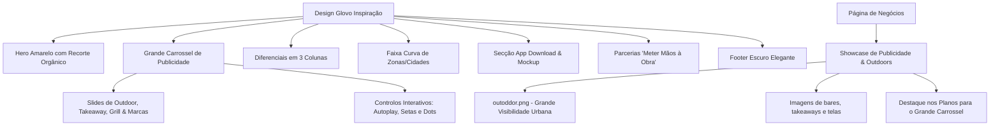

# Plano de Implementação: Kadiwa Spot como guia gastronómico e visibilidade para negócios

Manter a estrutura e energia visual actual do **Kadiwa Spot**, posicionando-o como um guia gastronómico local: um lugar para descobrir restaurantes, cafés, bares, menus, horários, contactos e formas de chegar. Para negócios, a proposta é presença digital e visibilidade, não logística.

---

## 1. Visão Geral das Mudanças

---

## 2. Mudanças Propostas

### 2.1. Estilos Globais & Identidade Visual ([css/estilos.css](file:///home/ghost/Desktop/HTML5/kadiwa_spot_V2/css/estilos.css))
- **Paleta de Cores Inspirada na Glovo**:
  - Amarelo primário vibrante: `#FFC244` / `#FFBA00`
  - Verde-azulado de ação (*Teal*): `#00A082` (hover: `#00846B`)
  - Grafite/Preto do rodapé: `#181A1B` / `#121212`
  - Fundo verde-menta suave para parcerias: `#EBF8F5`
  - Fundo neutro e cards brancos com sombras suaves (*soft elevation*)
- **Componentes & Efeitos**:
  - Pílulas arredondadas (*pills* `border-radius: 9999px`) para botões, busca e tags.
  - Recorte em ponta de balão de fala e ondas SVG na base do Hero e nas faixas.
  - Estilos para o **Grande Carrossel de Publicidade** (transições suaves, badges "Publicidade / Destaque", indicadores e botões de navegação circulares).
  - Grid de marcas/parceiros e cards com fotos circulares.

### 2.2. Página Inicial ([index.html](file:///home/ghost/Desktop/HTML5/kadiwa_spot_V2/index.html))
1. **Header Topbar**:
   - Logo Kadiwa Spot com visual limpo.
   - Navegação: *Início*, *Publicidade*, *Para Negócios*, *Zonas*, *FAQ*.
   - Botão de ação arredondado (*Teal*): **"Registar / Começar"**.
2. **Hero Amarelo Glovo**:
   - Fundo `#FFC244` com base recortada orgânica.
     - Esquerda: Visual gastronómico de um espaço ou prato local.
   - Direita:
     - Título: **"Descubra onde comer bem"**.
     - Subtítulo: *"Restaurantes, cafés, bares e sabores locais para conhecer na sua cidade."*
     - Barra de busca em cápsula branca: `Que lugar ou sabor procura?` com botão interativo **"Ver lugares perto de mim"** e botão **"Explorar"**.
3. **GRANDE CARROSSEL DE PUBLICIDADE** *(Substituindo a faixa tradicional)*:
   - Título da seção: **"Destaques & Publicidade Kadiwa"** com selo oficial de *Espaço Publicitário de Alto Impacto*.
   - Slides em formato banner widescreen e dinâmico:
     - **Slide 1 - Outdoor Kadiwa Spot**: "A sua marca em grandes formatos nas avenidas mais movimentadas de Maputo e Matola." (usando `media/imagens/outoddor.png`).
     - **Slide 2 - Sabores & Takeaway**: opções de fast-food, takeaway e bares para descobrir na cidade.
     - **Slide 3 - Grill & Sabores da Terra**: "Grelhados no ponto e carnes nobres selecionadas." (usando `media/imagens/GRILL.jpeg`).
     - **Slide 4 - Anuncie no Kadiwa Spot**: presença para negócios que querem ser encontrados por novos clientes. -> Botão "Quero Anunciar".
   - Controlos completos: Setas anterior/próximo, marcadores (*bullets*), pausa ao passar o mouse e autoplay.
4. **Secção "Tudo no Kadiwa Spot" (3 Colunas)**:
   - 1. *Os melhores restaurantes e takeaways da tua cidade*
   - 2. *Menus, horários e como chegar*
   - 3. *Espaços e marcas em destaque*
   - Botão pill teal: **"Descobre spots perto de ti"**.
5. **Faixa Curva Amarela: "Zonas onde estamos"**:
   - Fundo amarelo ondulado com ícone estilizado.
   - Pílulas brancas interativas: *Maputo Cidade, Polana, Sommerschield, Costa do Sol, Matola, Zimpeto, Beira, Nampula, Vilankulo, Inhambane, Tete, Pemba, Ponta do Ouro*.
6. **Secção "Descarregar a app"**:
   - Chamada para download, badges oficiais da App Store e Google Play, e mockup moderno de smartphones com o app Kadiwa.
7. **Secção Parcerias: "Meter mãos à obra, juntos"**:
   - Fundo verde-menta com ícone central de aperto de mãos.
   - 3 cards circulares com botão *"Registe-se aqui"*:
     - **Sugerir um espaço para o guia**
     - **Registe a sua empresa (Restaurantes & Bares)**
     - **Publicidade & Outdoors (Anuncie connosco)**
8. **Rodapé Escuro Moderno**:
   - Grafite `#181A1B`, links bem organizados, seletores de idioma e moeda (MZN).

### 2.3. Página de Negócios ([pages/negocios.html](file:///home/ghost/Desktop/HTML5/kadiwa_spot_V2/pages/negocios.html))
1. **Showcase de Publicidade, Outdoors e Takeaways**:
   - Integrar as imagens reais:
     - `media/imagens/outoddor.png`: Bloco de destaque para **"Publicidade em Outdoors de Grande Formato"**, explicando a visibilidade nas principais artérias e rotatórias de Moçambique.
     - Imagens gastronómicas: vitrine de **"Takeaways, Bares e Restaurantes"**, mostrando a experiência dos clientes e telas promocionais.
2. **Conexão com o Grande Carrossel**:
   - Destacar na tabela de preços e benefícios como os planos *Destaque* e *Premium* garantem presença de destaque no **Grande Carrossel da Página Inicial**.
3. **Harmonização Visual**:
   - Atualizar botões, badges e tipografia para o novo estilo inspirado na Glovo.

### 2.4. JavaScript Interativo ([js/script.js](file:///home/ghost/Desktop/HTML5/kadiwa_spot_V2/js/script.js))
- Implementar o motor do **Grande Carrossel de Publicidade**:
  - Transição suave (fade/slide), autoplay (5s), botões next/prev, dots interativos e pausa no hover.
- Adicionar suporte à ação **"Usar localização atual"** (HTML5 Geolocation API com preenchimento amigável da zona).
- Filtro interativo nas pílulas de zonas.

---

## 3. Plano de Verificação

### Testes Visuais e Funcionais:
1. **Verificação do Hero & Estética Glovo**:
   - Checar se o amarelo, recorte inferior e barra de busca estão fiéis à inspiração.
2. **Teste do Grande Carrossel de Publicidade**:
   - Verificar troca automática de slides, clique nas setas e clique nos pontos indicadores.
   - Conferir nitidez e posicionamento das imagens gastronómicas e promocionais.
3. **Teste da Página de Negócios (`pages/negocios.html`)**:
   - Conferir a exibição das fotos de outdoor e takeaway, textos comerciais e alinhamento com a nova identidade.
4. **Responsividade**:
   - Testar o comportamento em telas móveis e desktop para garantir alinhamento perfeito.
